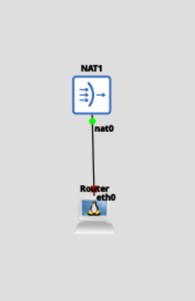

# Tutorial Praktikum Modul 2 — HTTP Server, DNS Server, dan Reverse Proxy

> **Catatan:** Ganti `[IP Prefix]` sesuai pembagian IP yang diumumkan. Penanda **INPUT SCREENSHOT** menunjukkan bagian yang perlu diberi screenshot. Dokumen ini hanya berisi tutorial, tanpa soal dan pertanyaan refleksi.

## 0. Persiapan Jaringan

| Node | Peran | Konfigurasi IP |
|---|---|---|
| Router | Akses internet melalui NAT | `eth0`: DHCP; `eth1`: `[IP Prefix].200.1/24` |
| Sargon, Iberia, Higashi | Client command line | DHCP |
| Ognisko | Client browser melalui VNC + Chromium | DHCP |
| Aegir | DHCP server | `[IP Prefix].200.10/24`, gateway `[IP Prefix].200.1`, pool `[IP Prefix].200.100–150` |
| Kazdel | HTTP server / reverse proxy | `[IP Prefix].200.11/24`, gateway `[IP Prefix].200.1` |
| Chernobog | DNS server (BIND) | `[IP Prefix].200.12/24`, gateway `[IP Prefix].200.1` |
| Web1 | Backend HTTP | `[IP Prefix].200.20/24`, port `8080` |
| Web2 | Backend HTTP + aplikasi Python | `[IP Prefix].200.21/24`, port `8080` dan `5000` |

### Konfigurasi Router dan DHCP

1. Buat topologi awal dan hubungkan `eth0` Router ke NAT.

   <p align="center">
    
   </p>
2. Buka console Router dan pastikan `eth0` mendapatkan IP melalui DHCP.
3. Jalankan:
   ```bash
   apk update
   apk add iptables
   iptables -t nat -A POSTROUTING -j MASQUERADE -o eth0 -s [IP Prefix].0.0/16
   ```
4. Uji koneksi internet:
   ```bash
   ping google.com
   ```
   **INPUT SCREENSHOT —** Output Router yang menunjukkan IP `eth0` dan ping berhasil.
5. Pada Aegir, atur DNS sementara dan uji koneksi:
   ```bash
   echo "nameserver 8.8.8.8" > /etc/resolv.conf
   ping google.com
   ```
6. Konfigurasikan DHCP server seperti pada Modul 1 dengan pool `[IP Prefix].200.100` sampai `[IP Prefix].200.150`. Tambahkan ke `dhcpd.conf`:
   ```text
   option router [IP Prefix].200.1
   ```
   **INPUT SCREENSHOT —** Konfigurasi DHCP Aegir yang menunjukkan pool dan opsi router.

---

## A. HTTP Server dengan Nginx

### A.1 Menyiapkan HTTP server pada Kazdel

1. Atur konfigurasi network interface Kazdel agar IP statis dan tetap tersimpan setelah restart:
   ```text
   auto eth0
   iface eth0 inet static
       address [IP Prefix].200.11
       netmask 255.255.255.0
       gateway [IP Prefix].200.1
   ```
   **INPUT SCREENSHOT —** Network configuration Kazdel dengan IP statis.
2. Install Nginx:
   ```bash
   echo "nameserver 8.8.8.8" > /etc/resolv.conf
   apk update
   apk add nginx
   ```
3. Buat direktori:
   ```bash
   mkdir -p /root/myconfig
   mkdir -p /root/myweb
   mkdir -p /root/mylogs
   ```
4. Buat `/root/myweb/index.html`:
   ```html
   <html>
   <head>
       <title>This is My Web</title>
   </head>
   <body><p>This is my web</p></body>
   </html>
   ```
5. Buat `/root/myconfig/nginx.conf`:
   ```nginx
   user root;
   worker_processes auto;
   worker_cpu_affinity auto;
   pid /tmp/nginx.pid;
   error_log /root/mylogs/error.log;

   events { worker_connections 768; }

   http {
       server {
           listen 80;
           server_name _;
           root /root/myweb;
           index index.html;

           location / {
               try_files $uri $uri/ =404;
           }
       }
   }
   ```
6. Buat `/root/myconfig/start_http.sh`:
   ```bash
   #!/bin/bash
   nginx -c /root/myconfig/nginx.conf -g 'daemon off;'
   ```
7. Jalankan Nginx:
   ```bash
   nginx -c /root/myconfig/nginx.conf
   ```
8. Agar otomatis berjalan saat node dinyalakan, tambahkan ke `/root/init.sh`:
   ```bash
   #!/bin/bash
   nginx -c /root/myconfig/nginx.conf
   ```
   **INPUT SCREENSHOT —** File konfigurasi Nginx dan/atau proses Nginx yang berjalan.
9. Dari Ognisko, buka console melalui VNC, klik kanan desktop, pilih **Desktops → chromium**, lalu akses `http://[IP Prefix].200.11`.

   **INPUT SCREENSHOT —** Browser yang menampilkan **This is my web**.
10. Dari Sargon, jalankan:
    ```bash
    curl -vL http://[IP Prefix].200.11
    ```
    **INPUT SCREENSHOT —** Output curl yang menunjukkan HTTP `200 OK` dan isi HTML.

---

## B. DNS Server dengan BIND

### B.1 Menyiapkan DNS untuk `netics.my.id`

1. Atur IP Chernobog menjadi `[IP Prefix].200.12/24` dan gateway `[IP Prefix].200.1`.

   **INPUT SCREENSHOT —** Konfigurasi IP Chernobog.
2. Buat direktori dan install BIND:
   ```bash
   mkdir -p /root/dns
   mkdir -p /root/dnsdata
   echo "nameserver 8.8.8.8" > /etc/resolv.conf
   apk update
   apk add bind
   ```
3. Buat `/root/dns/named.conf`:
   ```conf
   options {
       directory "/root/dns";
       listen-on { any; };
       allow-query { any; };
   };

   logging {
       channel default_log {
           file "/root/dns/named.log" versions 3 size 5m;
           severity info;
           print-time yes;
           print-severity yes;
           print-category yes;
       };
       category default { default_log; };
       category queries { default_log; };
   };

   zone "localhost" {
       type master;
       file "db.localhost";
   };

   zone "netics.my.id" {
       type master;
       file "db.netics.my.id";
   };
   ```
4. Buat `/root/dns/db.localhost`:
   ```dns
   $TTL 86400
   @ IN SOA localhost. root.localhost. (
       1
       3600
       1800
       604800
       86400
   )
   IN NS localhost.
   IN A 127.0.0.1
   ```
5. Buat `/root/dns/db.netics.my.id`:
   ```dns
   $TTL 86400
   @ IN SOA ns1.netics.my.id. admin.netics.my.id. (
       1
       3600
       1800
       604800
       86400
   )
   IN NS ns1.netics.my.id.
   ns1 IN A [IP Prefix].200.12
   www IN A [IP Prefix].200.11
   ```
6. Buat `/root/dns/start_dns.sh` dan jalankan:
   ```sh
   #!/bin/sh
   named -g -c /root/dns/named.conf
   ```
   ```bash
   chmod +x /root/dns/start_dns.sh
   /root/dns/start_dns.sh
   ```
7. Untuk memantau log, gunakan console lain atau tmux:
   ```bash
   tail -f /root/dns/named.log
   ```
8. Tambahkan ke `/root/init.sh` Chernobog agar DNS otomatis berjalan:
   ```bash
   #!/bin/bash
   chmod +x /root/dns/start_dns.sh
   /root/dns/start_dns.sh
   ```
   **INPUT SCREENSHOT —** Console Chernobog yang menunjukkan proses `named` atau log DNS.
9. Pada Aegir, tambahkan ke `dhcpd.conf`:
   ```text
   option dns [IP Prefix].200.12 8.8.8.8
   ```
10. Jalankan ulang DHCP server, lalu restart client agar menerima konfigurasi DNS baru.

    **INPUT SCREENSHOT —** Isi `dhcpd.conf` yang menunjukkan `option dns`.
11. Dari Sargon, verifikasi DNS dan HTTP:
    ```bash
    cat /etc/resolv.conf
    ping www.netics.my.id
    curl -vL http://www.netics.my.id
    ```
12. Dari Ognisko, akses `http://www.netics.my.id` melalui browser. Ulangi pengecekan dari client lain.

    **INPUT SCREENSHOT —** Output `resolv.conf`, ping/curl, dan browser yang berhasil membuka domain.

### B.2 Menambahkan zona `netics.org` dan virtual host kedua

#### DNS pada Chernobog

1. Tambahkan zona baru ke `/root/dns/named.conf`:
   ```conf
   zone "netics.org" {
       type master;
       file "db.netics.org";
   };
   ```
2. Buat `/root/dns/db.netics.org`:
   ```dns
   $TTL 86400
   @ IN SOA ns1.netics.org. admin.netics.org. (
       1
       3600
       1800
       604800
       86400
   )
   IN NS ns1.netics.org.
   ns1 IN A [IP Prefix].200.12
   web IN A [IP Prefix].200.11
   ```
3. Restart Chernobog agar konfigurasi baru terbaca.
4. Uji resolusi dari Sargon:
   ```bash
   ping ns1.netics.org
   ping www.netics.my.id
   ping web.netics.org
   ```
   **INPUT SCREENSHOT —** Hasil ping yang menunjukkan nama domain berhasil di-resolve.

#### Web server pada Kazdel

1. Buat direktori konten:
   ```bash
   mkdir -p /root/myweb-netics-org
   ```
2. Buat `/root/myweb-netics-org/index.html`:
   ```html
   <html>
   <head><title>Hello</title></head>
   <body><p>This is NETICS-ORG web</p></body>
   </html>
   ```
3. Ubah blok `http` di `/root/myconfig/nginx.conf` agar melayani dua domain:
   ```nginx
   http {
       server {
           listen 80;
           server_name www.netics.my.id;
           root /root/myweb;
           index index.html;
           location / {
               try_files $uri $uri/ =404;
           }
       }

       server {
           listen 80;
           server_name web.netics.org;
           root /root/myweb-netics-org;
           index index.html;
           location / {
               try_files $uri $uri/ =404;
           }
       }
   }
   ```
4. Restart Kazdel.
5. Verifikasi dari Sargon atau Iberia:
   ```bash
   curl -vL http://www.netics.my.id
   curl -vL http://web.netics.org
   ```
6. Dari Ognisko, buka kedua domain di browser:
   - `http://www.netics.my.id` → **This is my web**
   - `http://web.netics.org` → **This is NETICS-ORG web**

   **INPUT SCREENSHOT —** Hasil ping/curl dan tampilan browser kedua domain.

---

## C. Reverse Proxy

### C.1 Menyiapkan backend Web1

1. Atur IP statis Web1:
   ```text
   auto eth0
   iface eth0 inet static
       address [IP Prefix].200.20
       netmask 255.255.255.0
       gateway [IP Prefix].200.1
   ```
   **INPUT SCREENSHOT —** Konfigurasi interface Web1.
2. Install Nginx dan buat direktori:
   ```bash
   echo "nameserver 8.8.8.8" > /etc/resolv.conf
   apk update
   apk add nginx
   mkdir -p /root/myconfig /root/myweb /root/mylogs
   ```
3. Buat `/root/myweb/index.html` dengan isi:
   ```html
   <html>
   <head><title>This is My Web</title></head>
   <body><p>Ini WEB-1</p></body>
   </html>
   ```
4. Buat `/root/myconfig/nginx.conf` agar Nginx listen di port `8080`:
   ```nginx
   user root;
   worker_processes auto;
   worker_cpu_affinity auto;
   pid /tmp/nginx.pid;
   error_log /root/mylogs/error.log;

   events { worker_connections 768; }

   http {
       server {
           listen 8080;
           server_name _;
           root /root/myweb;
           index index.html;
           location / {
               try_files $uri $uri/ =404;
           }
       }
   }
   ```
5. Buat `/root/myconfig/start_http.sh`:
   ```bash
   #!/bin/bash
   nginx -c /root/myconfig/nginx.conf -g 'daemon off;'
   ```
6. Atur start command node seperti pada Bagian A, lalu restart Web1.
7. Verifikasi:
   ```bash
   curl http://[IP Prefix].200.20:8080
   ```
   **INPUT SCREENSHOT —** Output curl yang menampilkan **Ini WEB-1**.

### C.2 Menyiapkan backend Web2

1. Atur IP statis Web2:
   ```text
   auto eth0
   iface eth0 inet static
       address [IP Prefix].200.21
       netmask 255.255.255.0
       gateway [IP Prefix].200.1
   ```
2. Ulangi instalasi Nginx dan pembuatan direktori:
   ```bash
   echo "nameserver 8.8.8.8" > /etc/resolv.conf
   apk update
   apk add nginx
   mkdir -p /root/myconfig /root/myweb /root/mylogs
   ```
3. Buat `/root/myweb/index.html` dengan isi:
   ```html
   <html>
   <head><title>This is My Web</title></head>
   <body><p>Ini WEB-2</p></body>
   </html>
   ```
4. Gunakan konfigurasi Nginx seperti Web1, tetap listen di port `8080` dengan root `/root/myweb`. Buat `start_http.sh` yang sama, atur start command, lalu restart Web2.
5. Verifikasi:
   ```bash
   curl http://[IP Prefix].200.21:8080
   ```
   **INPUT SCREENSHOT —** Konfigurasi IP dan output curl yang menampilkan **Ini WEB-2**.

### C.3 Mengatur reverse proxy pada Kazdel

1. Pastikan IP Kazdel tetap `[IP Prefix].200.11/24`.
2. Ganti `/root/myconfig/nginx.conf` Kazdel dengan:
   ```nginx
   http {
       server {
           listen 80;
           server_name www.netics.my.id;

           location = /web1 {
               proxy_pass http://[IP Prefix].200.20:8080/;
               proxy_set_header Host $host;
               proxy_set_header X-Real-IP $remote_addr;
           }

           location = /web2 {
               proxy_pass http://[IP Prefix].200.21:8080/;
               proxy_set_header Host $host;
               proxy_set_header X-Real-IP $remote_addr;
           }
       }
   }
   ```
3. Restart Kazdel.
4. Dari Sargon, uji:
   ```bash
   curl http://www.netics.my.id/web1
   curl http://www.netics.my.id/web2
   ```
   `/web1` harus menampilkan **Ini WEB-1** dan `/web2` harus menampilkan **Ini WEB-2**.
5. Dari Ognisko, buka kedua path melalui browser.

   **INPUT SCREENSHOT —** Konfigurasi reverse proxy, hasil curl, dan browser untuk `/web1` serta `/web2`.

### C.4 Menambahkan aplikasi kalender pada Web2 (port 5000)

1. Buat direktori:
   ```bash
   mkdir -p /root/aplikasi
   ```
2. Install Python:
   ```bash
   echo "nameserver 8.8.8.8" > /etc/resolv.conf
   apk update
   apk add python3
   ```
3. Buat `/root/aplikasi/program.py` dengan kode berikut:
   ```python
import calendar
from datetime import datetime
from http.server import BaseHTTPRequestHandler, HTTPServer

PORT = 5000


class CalendarRequestHandler(BaseHTTPRequestHandler):

  def do_GET(self):
    # 1. Get current year and month
    now = datetime.now()
    year = now.year
    month = now.month

    # 2. Generate calendar data
    cal = calendar.Calendar(
        firstweekday=6
    )  # 6 = Sunday start. Change to 0 for Monday.
    month_days = cal.monthdayscalendar(year, month)
    month_name = calendar.month_name[month]

    # 3. Build HTML response
    html = f"""<!DOCTYPE html>
        <html lang="en">
        <head>
            <meta charset="UTF-8">
            <meta name="viewport" content="width=device-width, initial-scale=1.0">
            <title>{month_name} {year} - Calendar</title>
            <style>
                body {{
                    font-family: -apple-system, BlinkMacSystemFont, "Segoe UI", Roboto, sans-serif;
                    background-color: #f4f7f6;
                    display: flex;
                    justify-content: center;
                    align-items: center;
                    height: 100vh;
                    margin: 0;
                }}
                .calendar-container {{
                    background: #ffffff;
                    padding: 24px;
                    border-radius: 12px;
                    box-shadow: 0 4px 20px rgba(0, 0, 0, 0.08);
                    width: 100%;
                    max-width: 500px;
                }}
                h2 {{
                    text-align: center;
                    color: #2c3e50;
                    margin-top: 0;
                    margin-bottom: 20px;
                }}
                table {{
                    width: 100%;
                    border-collapse: collapse;
                }}
                th {{
                    background-color: #3498db;
                    color: white;
                    font-weight: 600;
                    padding: 12px 0;
                    width: 14.28%;
                    border-radius: 4px;
                }}
                td {{
                    text-align: center;
                    padding: 16px 0;
                    color: #333;
                    font-size: 16px;
                    font-weight: 500;
                }}
                .today {{
                    background-color: #e8f4fd;
                    color: #3498db;
                    border-radius: 50%;
                    font-weight: bold;
                }}
                .empty {{
                    color: #ccc;
                }}
            </style>
        </head>
        <body>
            <div class="calendar-container">
                <h2>{month_name} {year}</h2>
                <table>
                    <thead>
                        <tr>
                            <th>Sun</th>
                            <th>Mon</th>
                            <th>Tue</th>
                            <th>Wed</th>
                            <th>Thu</th>
                            <th>Fri</th>
                            <th>Sat</th>
                        </tr>
                    </thead>
                    <tbody>
        """

    # 4. Construct table rows from calendar data
    for week in month_days:
      html += "<tr>"
      for day in week:
        if day == 0:
          html += '<td class="empty">&bull;</td>'
        elif day == now.day:
          html += f'<td class="today">{day}</td>'
        else:
          html += f"<td>{day}</td>"
      html += "</tr>"

    html += """
                    </tbody>
                </table>
            </div>
        </body>
        </html>
        """

    # 5. Send HTTP Response headers and content
    self.send_response(200)
    self.send_header("Content-type", "text/html")
    self.end_headers()
    self.wfile.write(html.encode("utf-8"))


def run():
  server_address = ("", PORT)
  httpd = HTTPServer(server_address, CalendarRequestHandler)
  print(f"Server running at http://localhost:{PORT}/")
  try:
    httpd.serve_forever()
  except KeyboardInterrupt:
    print("\nServer stopped.")


if __name__ == "__main__":
  run()
   ```
4. Jalankan aplikasi:
   ```bash
   python3 /root/aplikasi/program.py
   ```
   **INPUT SCREENSHOT —** Console Web2 yang menunjukkan aplikasi berjalan pada port `5000`.
5. Uji akses langsung dari client:
   ```bash
   curl http://[IP Prefix].200.21:5000
   ```
   **INPUT SCREENSHOT —** Output curl yang menampilkan HTML kalender.
6. Pada Kazdel, tambahkan route `/app` ke konfigurasi reverse proxy. Konfigurasi server lengkap:
   ```nginx
   http {
       server {
           listen 80;
           server_name www.netics.my.id;

           location = /web1 {
               proxy_pass http://[IP Prefix].200.20:8080/;
               proxy_set_header Host $host;
               proxy_set_header X-Real-IP $remote_addr;
           }

           location = /web2 {
               proxy_pass http://[IP Prefix].200.21:8080/;
               proxy_set_header Host $host;
               proxy_set_header X-Real-IP $remote_addr;
           }

           location = /app {
               proxy_pass http://[IP Prefix].200.21:5000/;
               proxy_set_header Host $host;
               proxy_set_header X-Real-IP $remote_addr;
           }
       }
   }
   ```
7. Restart Kazdel.
8. Dari Sargon, uji:
   ```bash
   curl http://www.netics.my.id/web1
   curl http://www.netics.my.id/web2
   curl http://www.netics.my.id/app
   ```
9. Dari Ognisko, buka ketiga path melalui Chromium.

   **INPUT SCREENSHOT —** Hasil curl ketiga path dan browser yang menampilkan kalender di `/app`.

---

## D. Verifikasi Menyeluruh

| Pemeriksaan | Perintah / cara | Node |
|---|---|---|
| Client menerima DNS server | `cat /etc/resolv.conf` | Sargon |
| Resolusi nama domain | `ping www.netics.my.id`, `ping web.netics.org` | Sargon/client lain |
| Akses langsung backend | `curl http://[IP Prefix].200.20:8080`, `curl http://[IP Prefix].200.21:8080`, `curl http://[IP Prefix].200.21:5000` | Sargon |
| Reverse proxy mengarah ke backend yang benar | `curl http://www.netics.my.id/web1`, `/web2`, `/app` | Sargon/Iberia |
| Multi-domain web server | `curl http://www.netics.my.id`, `curl http://web.netics.org` | Sargon |
| Verifikasi browser | Buka domain dan path di atas | Ognisko |
| Header proxy | Gunakan `curl -vL` dan amati header | Sargon |

**INPUT SCREENSHOT —** Bukti pengujian DNS, akses langsung backend, reverse proxy, multi-domain, browser, dan header HTTP.

---

## E. Tugas Mandiri Bagian C — Menambahkan Web3

1. Gunakan konfigurasi dasar dari bagian sebelumnya.
2. Tambahkan node Web3 sebagai backend HTTP baru dan hubungkan ke jaringan.

   **INPUT SCREENSHOT —** Topologi GNS3 buatan sendiri yang memperlihatkan Web3 dan reverse proxy.
3. Konfigurasikan Web3 sebagai HTTP server dengan IP dan port backend sesuai topologi.
4. Tambahkan konfigurasi reverse proxy agar path `/web3` diteruskan ke Web3.
5. Tambahkan nama domain baru di DNS server, misalnya `app.netics.my.id`, yang mengarah ke reverse proxy.
6. Ubah konfigurasi reverse proxy agar Web3 dapat diakses melalui `app.netics.my.id` menggunakan **name-based virtual host**, selain domain yang sudah ada.
7. Uji menggunakan curl melalui path `/web3` dan domain baru.

   **INPUT SCREENSHOT —** Konfigurasi DNS/Nginx dan hasil curl yang menunjukkan Web3 bisa diakses.
8. Di Kazdel, gunakan `tmux` untuk menjalankan Nginx dan Termshark bersamaan. Lakukan packet capture ketika client mengakses Web3.
9. Buktikan bahwa nilai header `X-Real-IP` yang diterima Web3 sesuai dengan IP address client sebenarnya. Bandingkan source IP packet yang diterima Web3 dengan nilai `X-Real-IP`.

   **INPUT SCREENSHOT —** Capture Termshark dan bukti di Web3 yang menunjukkan source IP packet serta nilai `X-Real-IP`.
10. Sertakan perintah/konfigurasi dan penjelasan singkat untuk setiap bukti screenshot.
